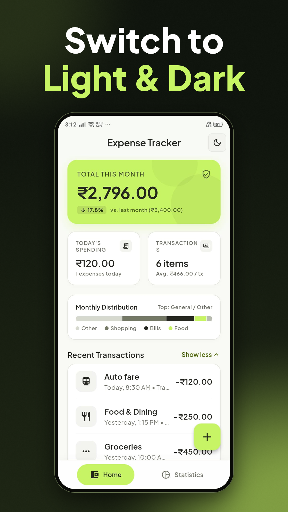
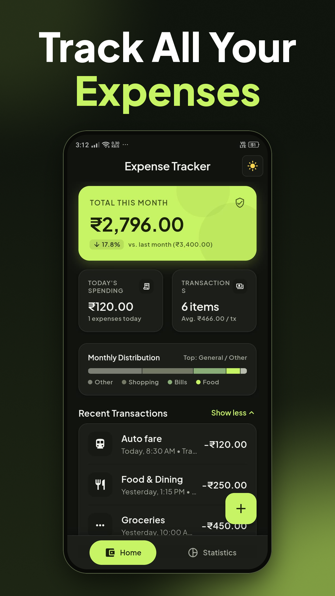
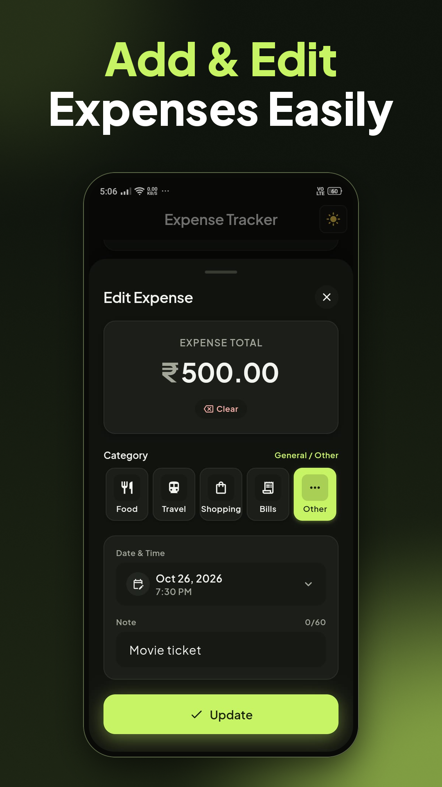
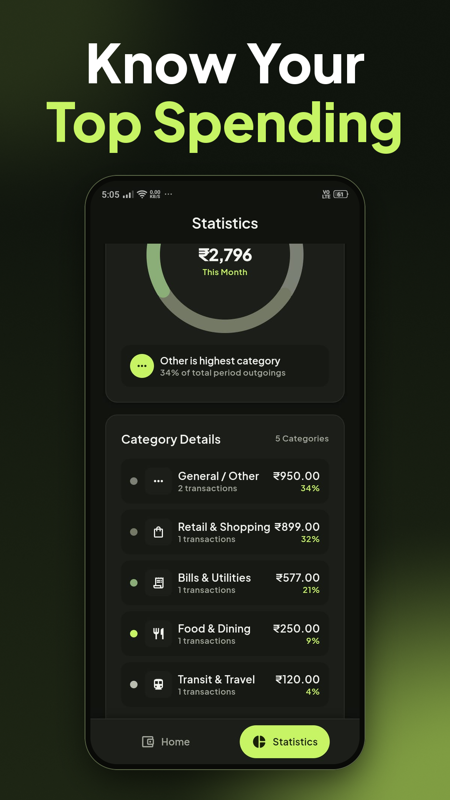
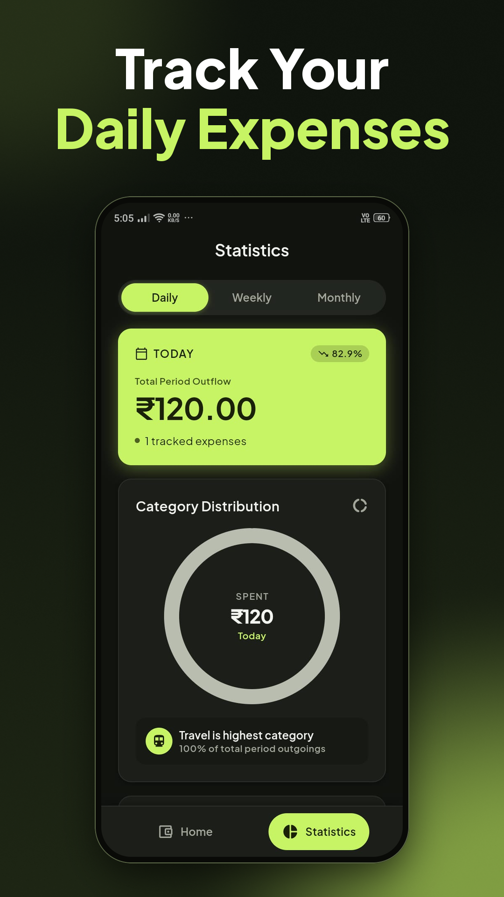
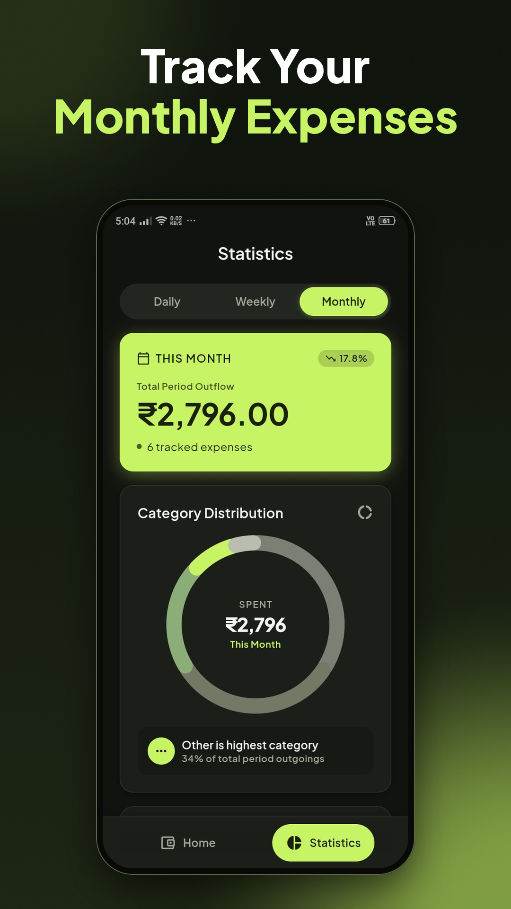

# 💰 Expense Tracker

This project is built for Google Play Store publishing using modern technologies, with **Google Stitch** for UI design and **Google Antigravity** for implementation.

## 📸 Screenshots

  <table>
    <tr>
      <td align="center">
        
      </td>
      <td align="center">
        
      </td>
      <td align="center">
        
      </td>
    </tr>
    <tr>
      <td align="center">
        
      </td>
      <td align="center">
        
      </td>
      <td align="center">
        
      </td>
    </tr>
  </table>

## 🚀 Features

- 💰 Add, edit, and delete expenses
- 📋 View recent transactions with expandable lists
- 🏷️ Organize expenses into 5 categories
- 📊 Track daily, weekly, and monthly spending
- 📈 Compare spending with previous periods
- 🔄 Spending trends (Increase, Decrease, New Spending, No Change)
- 🍩 Animated donut chart for category-wise spending
- 📉 Category distribution with percentage breakdown
- 🔍 View transaction details and spending statistics
- 🌗 Light and Dark theme support
- 💾 Offline-first local data persistence using Hive

## 🛠 Tech Used

- Flutter
- Dart
- flutter_riverpod
- Hive
- Hive Flutter
- Google Fonts (Plus Jakarta Sans)
- intl
- uuid

## 🏗 Architecture

This project follows a Clean Architecture:

- Clear separation of Presentation, Domain, and Data layers
- Repository pattern implementation
- Reactive state management using Riverpod
- Scalable and maintainable codebase

All expense data is stored locally on the device. No internet connection or account sign-in is required.

## 👨‍💻 Developer

Author: Anandu Udayan  
Email: anandu.dev180@gmail.com
